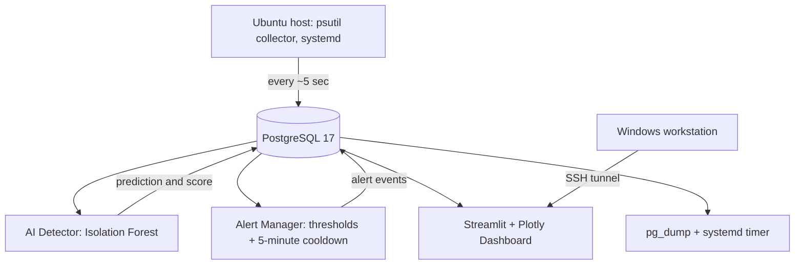

# AI Cloud Monitoring & Anomaly Detection | Ubuntu VPS (Sumopod)

**Python · Docker Compose · PostgreSQL 17 · Isolation Forest · Streamlit · systemd**

A self-hosted cloud infrastructure monitoring prototype deployed on an Ubuntu VPS (Sumopod). A host-level Python collector records CPU, memory, and disk utilization in PostgreSQL; an Isolation Forest service scores new samples; a separate alert manager applies resource thresholds and cooldown; a Streamlit dashboard visualizes events. Backup automation and rollback-oriented deployment were also tested.

> **Release state: v1.0 candidate.** Repository publication and final production alert-policy verification are separate from successful earlier tests. The VPS-specific candidate model was evaluated **offline on Windows** and has **not been confirmed deployed to production**. The static dashboard below is a historical results illustration, **not live monitoring**.

## Portfolio preview

- [Offline historical-results dashboard](portfolio/dashboard-offline.html) — open this HTML directly in a browser; no VPS or Python server required.
- [Full technical report](docs/technical-report.md)
- [Architecture](docs/architecture.md) · [Testing & evidence](docs/testing.md) · [Deployment](docs/deployment.md) · [Backup & recovery](docs/disaster-recovery.md)

> Screenshots: add an authentic dashboard capture to `assets/screenshots/` once reviewed to avoid leaking hostname, IP address, credentials or private details.

## System architecture



## Validated historical VPS metrics

| Metric | Value |
|---|---:|
| Exported records / valid records | **11,804 / 11,804** |
| Monitoring interval (median) | **5.008872 seconds** |
| Exported time range | **2026-11-04 16:14:02 → 2026-11-05 08:58:02** (database timestamps) |
| Collection duration | **16h 44m** |
| Missing / duplicate IDs / out-of-range records | **0 / 0 / 0** |
| Intervals longer than 15 seconds | **1** |
| Mean CPU / RAM / disk utilization | **3.30% / 58.18% / 46.81%** |

### VPS-model candidate evaluation (offline; not production deployment)

- Chronological split: **9,443 training records** and **2,361 held-out records**.
- Held-out predictions: **2,289 normal**, **72 anomalous** (**3.05%** anomaly rate).
- Six synthetic scenario expectations: **4/6 matches**. In particular, *disk 99%* was predicted **normal** and *CPU 35%* was predicted **anomalous** despite the scenario's expected-normal label.
- **Do not interpret 3.05% as accuracy**, or 4/6 as real-world model accuracy. No authoritative ground-truth labels are available for these observations.

## What was demonstrated

- Docker Compose ran PostgreSQL, AI Detector, Alert Manager and Streamlit dashboard simultaneously; PostgreSQL displayed healthy.
- Host collector wrote metrics to PostgreSQL (log entries ended with `SAVED`).
- Initial alert rules: **18 passing tests** (9 rules, 5 cooldown, 4 database integration), plus **5 controlled tests** with a temporary table/rollback on the VPS, as reported during development.
- An additional **6 candidate-model compatibility tests passed on Windows**.
- Scheduled local PostgreSQL backup was reported operational. A complete independent restore verification has not been evidenced in the provided outputs.
- Later threshold-only critical alert logic was proposed to prevent missed disk-full alerts; **confirm tests and VPS deployment before claiming this change production-active**.

## Run and verify

The authoritative executable files are in this repository's existing `src/`, `dashboards/`, `tests/`, `Dockerfile`, `compose.cloud.yaml`, `schema.sql` and `requirements.txt`. The accompanying docs should be merged with those actual source files; this documentation pack does **not** replace them.

```powershell
# Windows: example local verification
.\.venv\Scripts\python.exe -m unittest discover -s tests -p 'test_alert*.py' -v
.\.venv\Scripts\python.exe -m unittest discover -s tests -p 'test_vps_model_compatibility.py' -v
```

```bash
# On the Ubuntu VPS
sudo systemctl is-active ai-cloud-collector
sudo docker compose -f compose.cloud.yaml ps
sudo docker compose -f compose.cloud.yaml logs --tail=30 ai-detector
```

For operational configuration see [deployment](docs/deployment.md). Never commit `.env`, backups, private keys, raw production datasets, or model pickles without a deliberate security review.

## Scope and limitations

This is an educational/portfolio prototype, **not a production-certified service**. Offline model evaluation is not labeled incident detection; deployment and rollback require an explicit change window; persistent app availability has not been validated by a full server reboot test. Current evidence describes a historical snapshot, not a live service availability guarantee.

