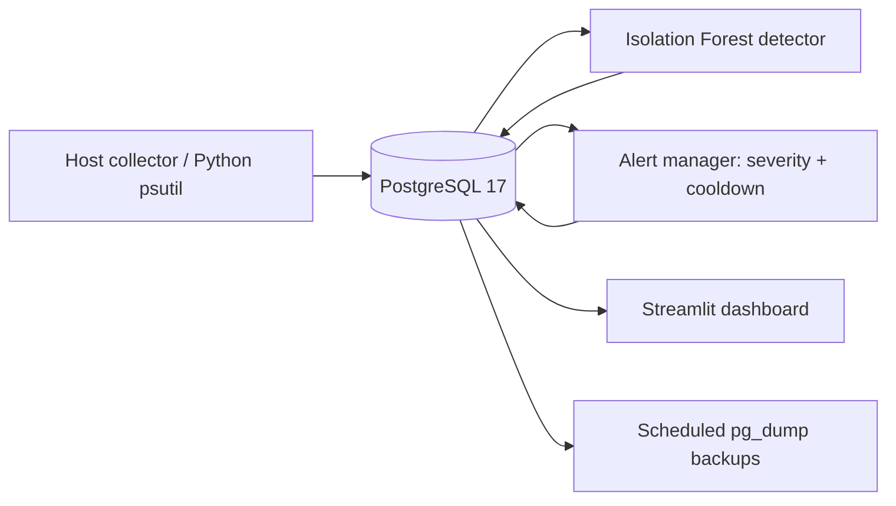

# System Architecture

## Logical pipeline

The collector runs on the **Ubuntu host** (not the detector container) to sample host metrics. Docker Compose runs `postgres`, `ai-detector`, `alert-manager`, and `dashboard`. The dashboard is published only at the server's loopback address (`127.0.0.1:8502`), accessed via an SSH port forward; the database similarly uses `127.0.0.1:15432`.

## Stored data

- `system_metrics`: timestamp, CPU, RAM, disk utilization.
- `anomaly_predictions`: foreign key to metric, Isolation Forest prediction and score.
- `system_alerts`: alert messages, severity and timestamps.

## Data interpretation

Anomaly detection and resource criticality are distinct. The observed candidate Isolation Forest model did not flag a synthetic disk usage of 99%; a hard disk-capacity critical rule must not depend exclusively on ML prediction. A threshold-only change was proposed and locally specified; record the final deployment status only after verifying the container code and tests.

## Operational boundaries

Collector is managed by systemd, app services by Docker. Docker restart policies reduce some outages but do not guarantee startup ordering, no data gaps, or recovery after host failure. A backup is only recovery-ready once restored and checked in an isolated database.
